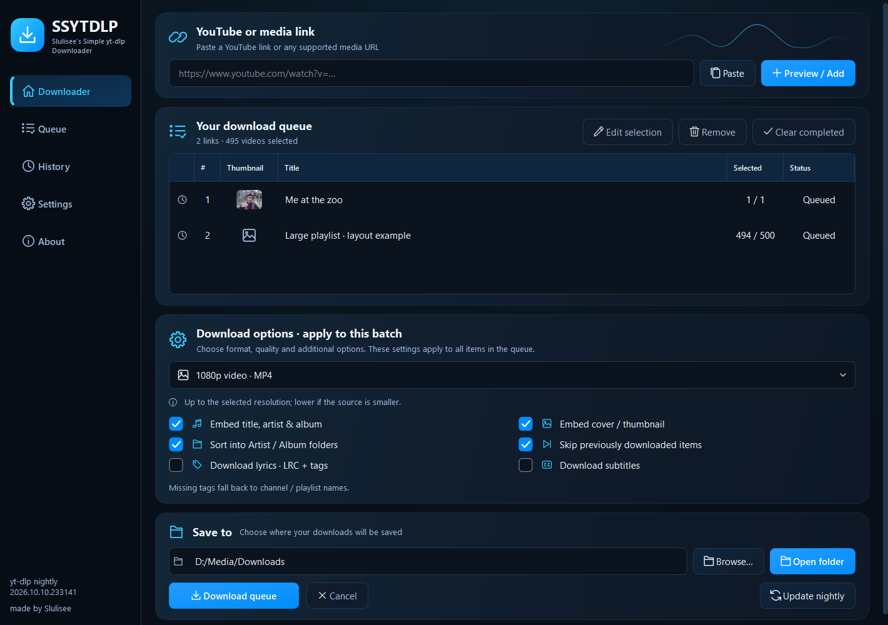

# SSYTDLP

**Slulisee's Simple yt-dlp Downloader** · made by Slulisee

A small, practical desktop GUI for **yt-dlp nightly**. Preview playlists, choose
what you want, queue several links, and download when you're ready.

[Download](https://github.com/Slulisee/SSYTDLP/releases/latest) ·
[Install](docs/INSTALL.md) · [How to use](docs/USAGE.md) ·
[Changelog](CHANGELOG.md) · [Validation](docs/VERIFICATION-v1.1.0.md) · [Contribute](CONTRIBUTING.md)

## What it does

- Video presets: 1080p MP4, 720p MP4 and best-quality MKV.
- Audio presets: MP3, M4A, Opus and FLAC.
- Select individual playlist entries, then stage multiple videos or playlists.
- Choose your download folder, embed metadata and covers, and sort Artist / Album folders.
- Optional lyrics: timed LRC, plain text and supported embedded lyric tags.
- Optional subtitles: language selection, automatic captions and video embedding.
- Sixteen visual themes, custom colors and wallpaper; English / German / Spanish / French UI.
- Full-height playlist queue with search, source filters and real metadata thumbnails.
- Optional completed-download handoff to SSMP.
- Saved queues, cancellation, resume and duplicate skipping.
- Official nightly engine updates with SHA256 verification.

## Install

**Windows x64:** download the Windows ZIP from [Releases](https://github.com/Slulisee/SSYTDLP/releases/latest),
extract the **whole archive**, and run `SSYTDLP.exe`. Keep `_internal` and `tools` beside it.
Windows release builds include FFmpeg, ffprobe, Deno and yt-dlp nightly.

**macOS / Linux:** see the [platform installation guide](docs/INSTALL.md).
You can run the source or build on your target OS. FFmpeg is installed separately.
Native CI archives are unsigned; see the workflow results attached to each release.
Interactive download testing was performed on Windows; macOS/Linux desktop behavior
still needs community testing even when the native build passes CI.

## Use it

1. Paste a link and choose **Preview / Add**.
2. Select entries in the preview, then **Add to queue**. Repeat for more links.
3. Choose a preset, destination and optional metadata, lyrics or subtitles.
4. Press **Download queue**.

Open **Queue** to browse every video inside your playlists, search, and edit selections.
Open **Settings → Appearance** for sixteen visual themes and your own colors.
See the [appearance guide](APPEARANCE.md) and optional [SSMP handoff](SSMP-INTEGRATION.md).
The [usage guide](docs/USAGE.md) explains selections, service imports and retries.

## Music services

YouTube, YouTube Music, SoundCloud and supported public media pages use yt-dlp.
Spotify, Deezer and Apple Music links import **public catalog metadata** and find
a matching recording on YouTube. The preview and log identify that route.
Spotify/Deezer public playlists are supported; Apple Music playlists are not.
Spotify embeds may expose only a subset. Lyrics are supplied by LRCLIB through
the community `syncedlyrics` library and depend on a confident match.

See [research, credits and tested examples](RESEARCH.md) and the
[personal-use notice](DISCLAIMER.md). Only download material you have permission
to save. Personal use does not itself grant copying rights.

## More previews

| Carbon monochrome | Visual theme selection |
| --- | --- |
|  |  |

Screenshots capture the real Windows UI. The queue preview combines a public
YouTube metadata example with an explicitly labeled generated layout playlist.
No media downloads or personal settings are included in this repository.
Layout and window decoration vary by platform.

## Source and development

The complete application source, tests and build scripts are public in `source/`.
Python 3.12 is required; the pinned requirements install PySide6/Qt. See [BUILD.md](docs/BUILD.md) for the commands.
No API key or account login is required for the implemented public-source routes.

SSYTDLP's own source is [MIT licensed](LICENSE). Dependencies retain their own
open-source licenses, including GPL components in packaged builds; see
[THIRD_PARTY.md](THIRD_PARTY.md) and `licenses/` for notices and source links.

Updates go into [CHANGELOG.md](CHANGELOG.md), with release notes and checksums
published on [GitHub Releases](https://github.com/Slulisee/SSYTDLP/releases).
Please include your OS, app version, nightly version and a redacted log when
[reporting a bug](https://github.com/Slulisee/SSYTDLP/issues).
