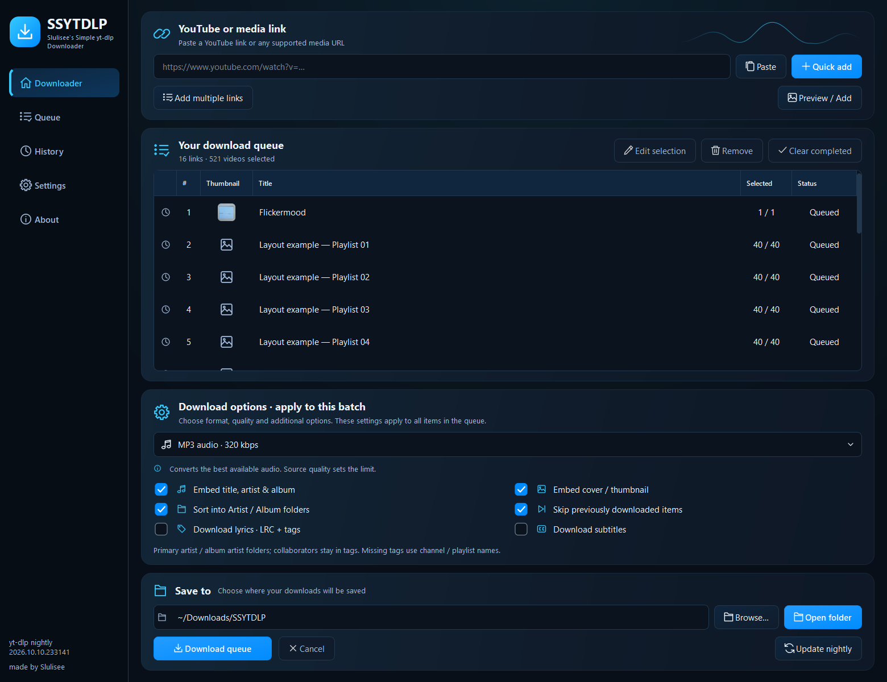
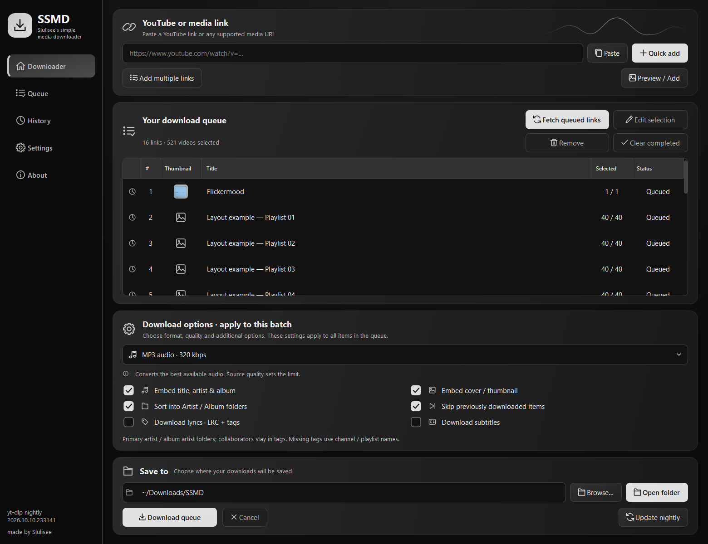
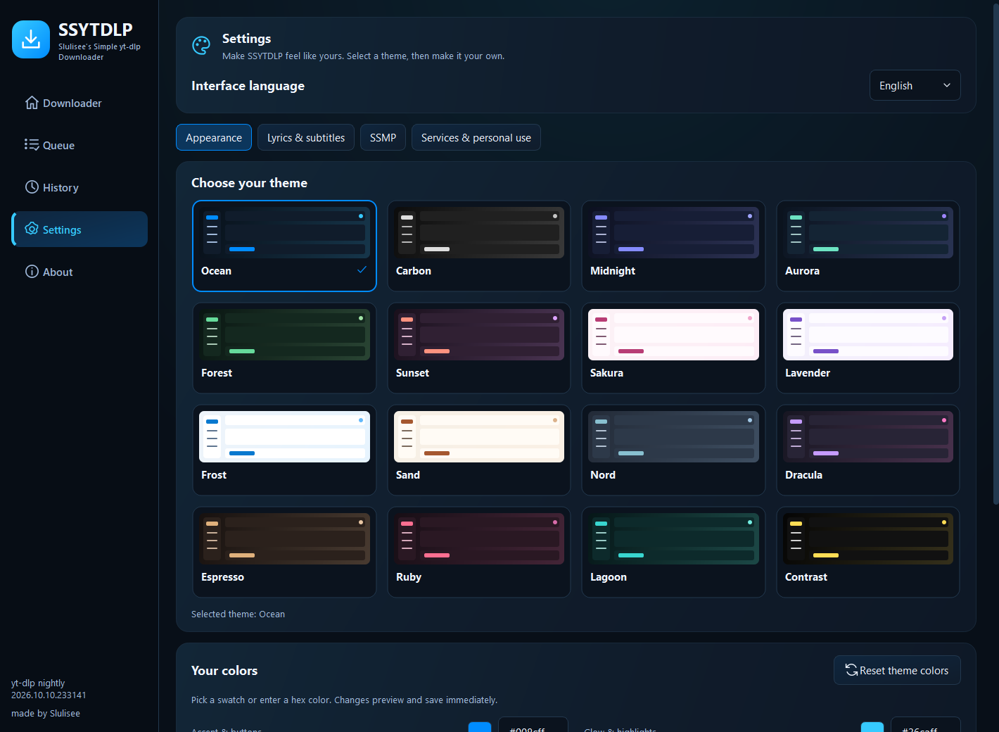
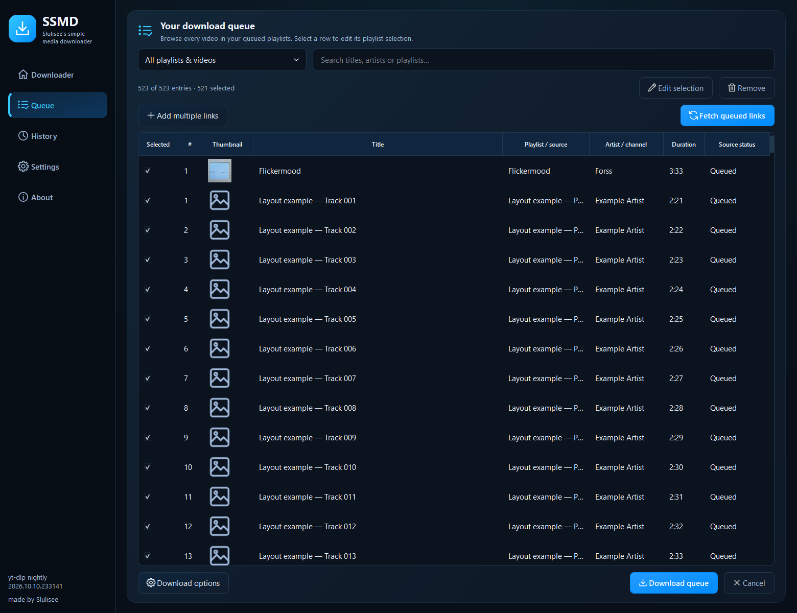
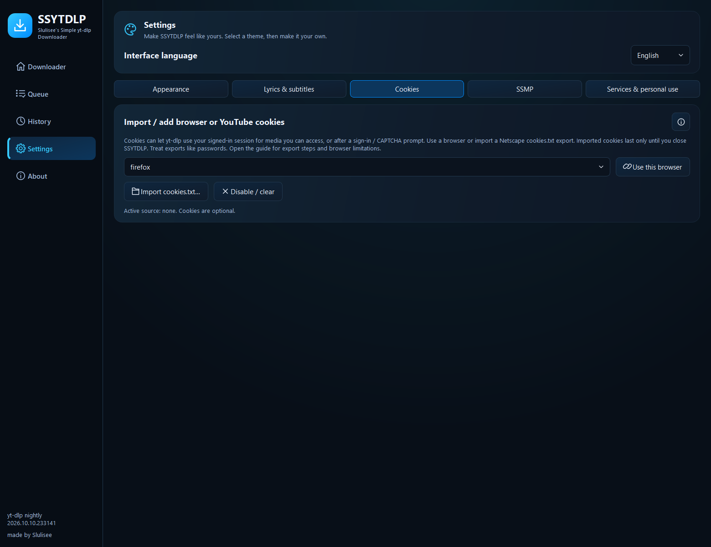
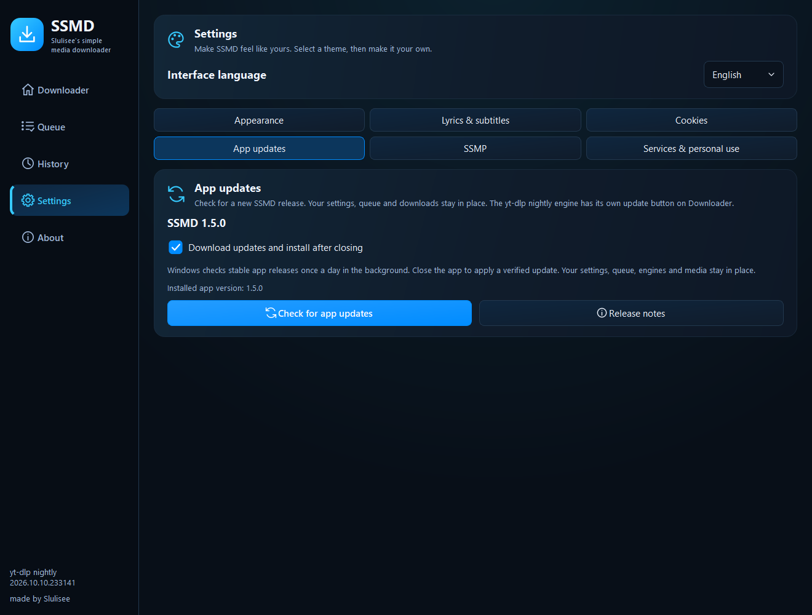

# SSMD

**Slulisee's simple media downloader** · made by Slulisee

Formerly SSYTDLP. The repository URL stays the same so existing app updaters
continue to work. Version 1.4.0 introduced the rename and upgrades the existing app and imports its saved
settings, queue and wallpaper into SSMD without deleting the old data.

A small, practical desktop GUI for **yt-dlp nightly**. Collect links first,
fetch playlists together, choose what you want, and download when you're ready.

[Download](https://github.com/Slulisee/SSYTDLP/releases/latest) ·
[Install](docs/INSTALL.md) · [How to use](docs/USAGE.md) ·
[Changelog](CHANGELOG.md) · [Validation](docs/VERIFICATION-v1.5.0.md) · [Contribute](CONTRIBUTING.md)

## What it does

- Video presets: 1080p MP4, 720p MP4 and best-quality MKV.
- Audio presets: MP3, M4A, Opus and FLAC.
- Quick Add and multiline bulk links; batch fetch without repeated preview dialogs.
- Select individual playlist entries, then stage multiple videos or playlists.
- Choose your download folder, embed metadata and covers, and sort Artist / Album folders.
- Optional lyrics: timed LRC, plain text and supported embedded lyric tags.
- Optional subtitles: language selection, automatic captions and video embedding.
- Sixteen visual themes, custom colors and wallpaper; English / German / Spanish / French UI.
- Full-height playlist queue with search, source filters and real metadata thumbnails.
- Optional completed-download handoff to SSMP.
- Saved queues, cancellation, resume and duplicate skipping.
- Official nightly engine updates with SHA256 verification.
- Optional browser cookies or session-only cookies.txt import, with a built-in guide.
- Windows installer with upgrades, plus an in-app update checker and verified downloads.

## Install

**Windows x64:** download **SSMD-Windows-AMD64-Setup.exe** from
[Releases](https://github.com/Slulisee/SSYTDLP/releases/latest), run setup, and open
SSMD from the Start menu. No administrator account is needed. A portable ZIP is
also available; extract the whole archive and keep `_internal` and `tools` beside `SSMD.exe`.
Windows release builds include FFmpeg, ffprobe, Deno and yt-dlp nightly.

Version 1.5.0 enables daily background app-update checks on Windows. Verified updates install silently after all app windows close. Disable **Download updates and install after closing** in Settings → App updates to keep updates manual.

For a manual check, open **Settings → App updates → Check for app updates**.
Windows can download a smaller update and open setup in the existing app folder.
Your settings, queue, downloads and existing nightly engine remain in place.
See the [upgrade guide](docs/UPDATES.md), including older portable copies.

**macOS / Linux:** see the [platform installation guide](docs/INSTALL.md).
You can run the source or build on your target OS. FFmpeg is installed separately.
Native CI archives are unsigned; see the workflow results attached to each release.
Interactive download testing was performed on Windows; macOS/Linux desktop behavior
still needs community testing even when the native build passes CI.

## Use it

1. Paste a link and press **Quick add** (or Enter), or use **Add multiple links**.
2. Click **Fetch queued links** on the Downloader page or in **Queue**. Review all playlist entries together and edit selections as needed.
3. Choose a preset, destination and optional metadata, lyrics or subtitles under **Download options**.
4. Press **Download queue**. Single-link **Preview / Add** remains optional.

Open **Queue** to browse every video inside your playlists, search, and edit selections.
Open **Settings → Appearance** for sixteen visual themes and your own colors.
See the [appearance guide](APPEARANCE.md) and optional [SSMP handoff](SSMP-INTEGRATION.md).
The [usage guide](docs/USAGE.md) explains selections, service imports and retries.
See [cookie import and browser setup](docs/COOKIES.md) and [bulk queues, artist folders and lyric matching](docs/QUEUE-AND-METADATA.md).

## Music services

YouTube, YouTube Music, SoundCloud and supported public media pages use yt-dlp.
Spotify, Deezer and Apple Music links import **public catalog metadata** and find
a matching recording on YouTube. The preview and log identify that route.
Spotify/Deezer public playlists are supported; Apple Music playlists are not.
Spotify embeds may expose only a subset. Lyrics are supplied by LRCLIB through
the community `syncedlyrics` library and depend on a confident match.

See [research, credits and tested examples](RESEARCH.md) and the
[personal-use notice](DISCLAIMER.md). Only download material you have permission
to save. Personal use does not itself grant copying rights.

## More previews

| Carbon monochrome | Visual theme selection |
| --- | --- |
|  |  |

Screenshots capture the real Windows UI. The queue preview combines a public
SoundCloud metadata example with explicitly labeled generated layout playlists.
No media downloads or personal settings are included in this repository.
Layout and window decoration vary by platform.

## Source and development

The complete application source, tests and build scripts are public in `source/`.
Python 3.12 is required; the pinned requirements install PySide6/Qt. See [BUILD.md](docs/BUILD.md) for the commands.
No API key or account login is required for the implemented public-source routes.

SSMD's own source is [MIT licensed](LICENSE). Dependencies retain their own
open-source licenses, including GPL components in packaged builds; see
[THIRD_PARTY.md](THIRD_PARTY.md) and `licenses/` for notices and source links.

Updates go into [CHANGELOG.md](CHANGELOG.md), with release notes and checksums
published on [GitHub Releases](https://github.com/Slulisee/SSYTDLP/releases).
Please include your OS, app version, nightly version and a redacted log when
[reporting a bug](https://github.com/Slulisee/SSYTDLP/issues).
