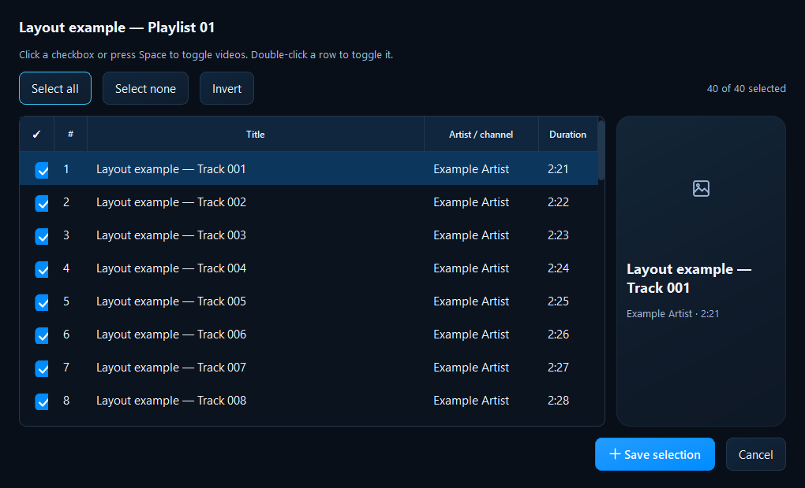
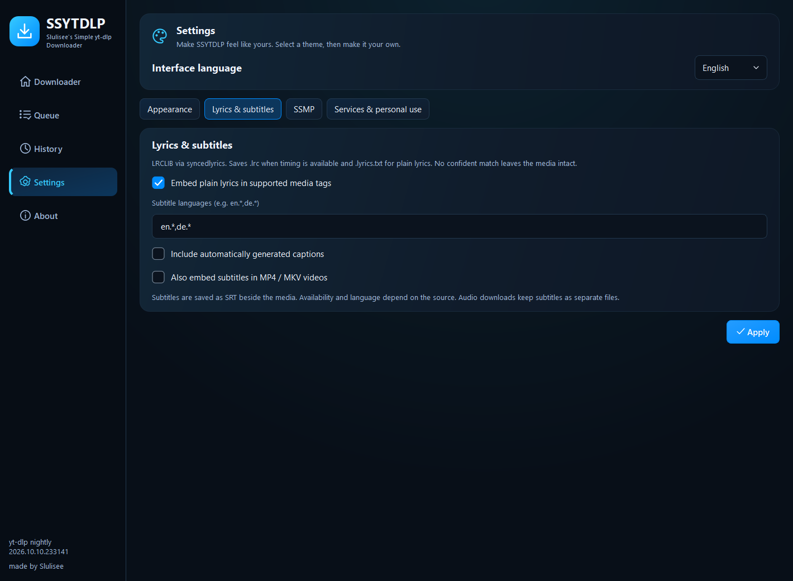
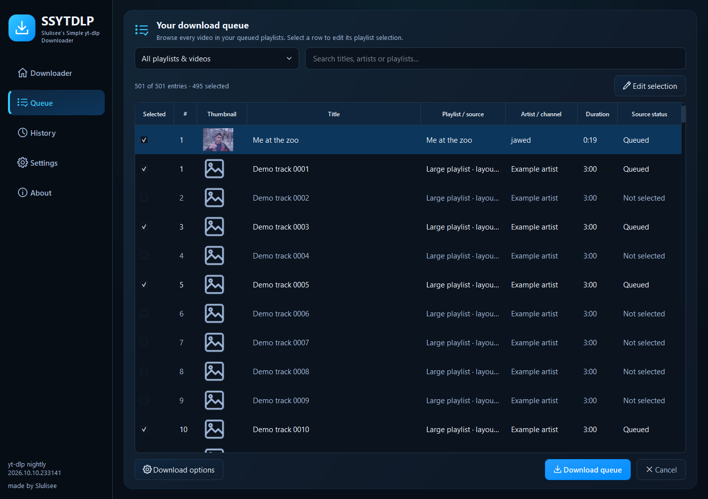

# How to use SSYTDLP

## Add links first, download later

1. Copy a video, playlist or supported music-service link into the link field.
2. Click **Quick add**, or press Enter. This saves the link without a network request. Use **Add multiple links** to paste a multiline list.
3. Open **Queue → Fetch queued links** to load the collected sources together. Available entries start selected. No per-link preview dialog opens.
4. Use **Edit selection** to choose entries. Click a checkbox, double-click a row, or select rows and press Space. Use **Select all**, **Select none** or **Invert**. **Preview / Add** is also available for optional single-link preview.
5. Pick a preset and choose **Save to** → **Browse** for the destination.
6. Set the optional checkboxes, then click **Download queue**.

Unavailable entries stay visible but cannot be selected. Original playlist
positions determine numbering. If a playlist changes, remove and add it again
to refresh the cached preview. Double-click a queue row to edit its selection.

## Presets and metadata

Use 1080p or 720p for MP4 video, or best-quality MKV. MP3, M4A, Opus and FLAC
presets produce audio. Presets cap video resolution; they do not upscale a
smaller source. Conversion cannot recover detail lost in the original audio.

Enable **Embed metadata**, **Embed cover / thumbnail**, and **Sort by Artist / Album**
as needed. Missing artist falls back to uploader; missing album falls back to
playlist title or `Singles`. When album artwork is absent, the source thumbnail
is used. Public catalog imports supply their available artist/album fields.
Repeated artist names are removed from credits. Organized folders use album artist or the primary artist, while distinct collaborators remain in tags. Existing media is not moved. See the [folder and queue guide](QUEUE-AND-METADATA.md).

## Lyrics and subtitles

Enable **Download lyrics · LRC + tags** for LRCLIB matching through syncedlyrics.
A confident match saves timed `.lrc` when available, plain `.lyrics.txt`, and a
`.lyrics.json` attribution note. Settings can also enable embedding plain lyrics
in MP3, M4A, Opus, FLAC and MP4. MKV uses sidecars. Existing lyrics are preserved.
An unavailable match leaves your completed media intact.

Enable **Download subtitles**, then open Settings → **Lyrics & subtitles**.
Use comma-separated language filters such as `en.*,de.*`. You can include
automatic captions and embed subtitle tracks into MP4/MKV. SRT sidecars are
kept with audio downloads. Availability and transcription quality depend on the source.

## Music links

SoundCloud and supported public sites use yt-dlp directly. Spotify and Deezer
public tracks, albums and playlists, plus Apple Music tracks/albums, import
catalog information and find matching YouTube recordings. Preview identifies the
provider; the log identifies the actual audio source. Apple Music playlists are
not supported. A public Spotify embed may contain only part of its playlist.

Lyrics lookups send title/artist/duration to LRCLIB; matching sends a search to
YouTube. Optional **Settings → Cookies** can pass a browser session or an imported cookie file to the nightly engine. Imports last only for this session; see the [cookie guide](COOKIES.md). Details: [personal-use
and privacy notice](../DISCLAIMER.md).

## Queue, retry and appearance

**Cancel** stops the active download and retains partial files and pending links.
Start again with the same preset and folder to resume. An error does not stop
later queue sources. **Clear completed** removes finished queue entries.

Completed sources are skipped until you edit their selection. Lyrics/subtitle
combinations have separate archive profiles. To retry an optional provider
failure, edit the completed source and temporarily disable **Skip previously
downloaded items**. Existing media files are preserved.

Settings → **Appearance** offers sixteen visual themes, custom colors, four interface languages and
wallpaper. The app copies the wallpaper into its settings folder. Remove it
independently of the theme. Queue, appearance and destination preferences survive restarts.

## Browse a large playlist

Open **Queue** in the sidebar. Every staged playlist/video is expanded into its
entries, including unselected and unavailable items. Choose a source in the
dropdown or search by title, artist or playlist. Select a row and click
**Edit selection**, or double-click it, to reopen that source's selection editor.
The selection marks are indicators; use the editor to change the selected videos.
The source status column reports the playlist's download state. Progress and
cancellation remain available during downloads; selection editing resumes when idle.

Metadata thumbnails load only as needed and share a bounded cache. Missing or
failed artwork uses a fallback icon. The compact downloader row uses artwork from
the first selected entry with a thumbnail, or another entry when necessary.
